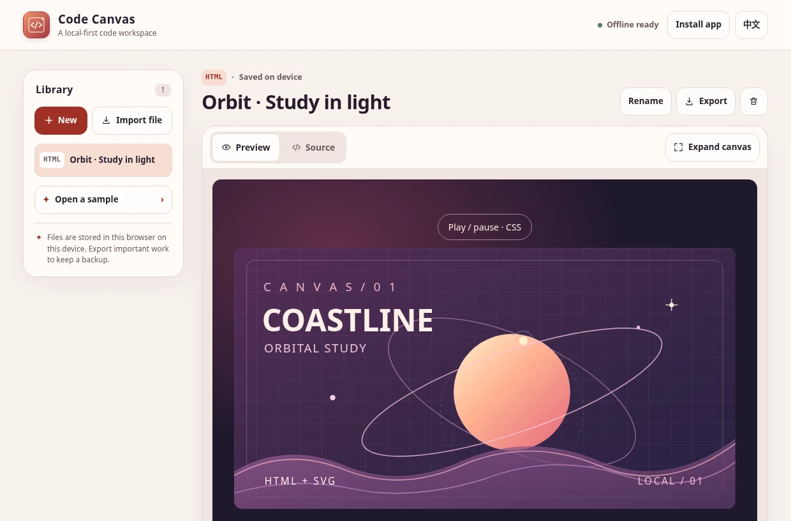
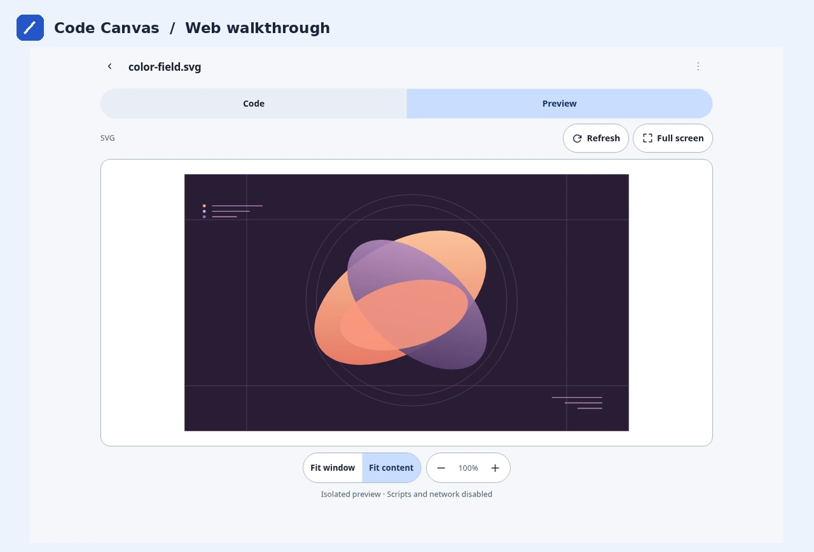

# Code Canvas

[简体中文](README.md) · [Open the web app](https://dsh.zhuquan.xyz/code-canvas/app/?lang=en) · [Download for Android](https://github.com/zhuquan7237/code-canvas/releases/latest) · [English walkthrough](https://dsh.zhuquan.xyz/code-canvas/en/#demo)

Turn code from an AI chat or a local file into **something you can preview, edit, and export**. No account required. Your source and drafts stay on this device.

## Choose your edition

| I want to… | Use this |
| --- | --- |
| Try it directly on Windows, Mac, iPhone, iPad, or Android | [Open the PWA](https://dsh.zhuquan.xyz/code-canvas/app/?lang=en). It supports isolated HTML and SVG previews, text editing, local drafts, and export. After the app loads and caches successfully, compatible browsers can open it offline. |
| Open more formats or work with native Android file sharing | [Download the APK](https://github.com/zhuquan7237/code-canvas/releases/latest) for Android 8.0 or later. It supports HTML, SVG, Markdown, Mermaid, JSON/JSONL, XML, YAML, CSV, common code and text formats, images and animations, and PDF. Available operations depend on the format. |
| Explore the native Apple design | [SwiftUI design prototype](https://github.com/zhuquan7237/code-canvas/releases/tag/v0.6.6). It is Xcode source, not an installable production iOS app. |
| Use the existing native Windows utility | [Windows native v0.5.0](https://relay.zhuquan.xyz/dl/CodeCanvas-Setup-0.5.0.exe). It is separate from the PWA and has its own feature set and version. |

## Quick start

1. Open the web app. Load the sample, paste code, or import a local file.
2. Use **Preview** to see the result and **Source** to edit. Web HTML and SVG previews do not execute scripts or load network resources. Other text formats are readable as source.
3. **Export** a copy you want to keep. Web drafts are local to this browser and do not sync. Export before clearing site data. This preview supports files up to 512 KB and up to eight local drafts.

**Android:** use Paste or share a file to the app. The library offers search, type filters, list and grid views.
**iPhone or iPad:** open the web app in Safari, then Share → Add to Home Screen. Enable Open as Web App if offered. [Apple’s instructions](https://support.apple.com/guide/iphone/iphea86e5236/ios)

## Watch the walkthrough

[Watch in English](https://dsh.zhuquan.xyz/code-canvas/en/#demo) · [中文配音与双语字幕](https://dsh.zhuquan.xyz/code-canvas/#demo)

## Development

- [Web source](web/app/): serve locally with `python3 -m http.server 8000 -d web/app` and open `http://localhost:8000/`. Opening the HTML file directly does not enable offline caching.
- [Android source](app/): use JDK 17 and Android SDK 35, then run `./gradlew testDebugUnitTest assembleDebug`. Do not install a debug-signed build over a release APK.
- [Android history](docs/ANDROID-HISTORY.md) · [Verification records](docs/VERIFICATION.md) · [Releases](https://github.com/zhuquan7237/code-canvas/releases) · [License](LICENSE)
