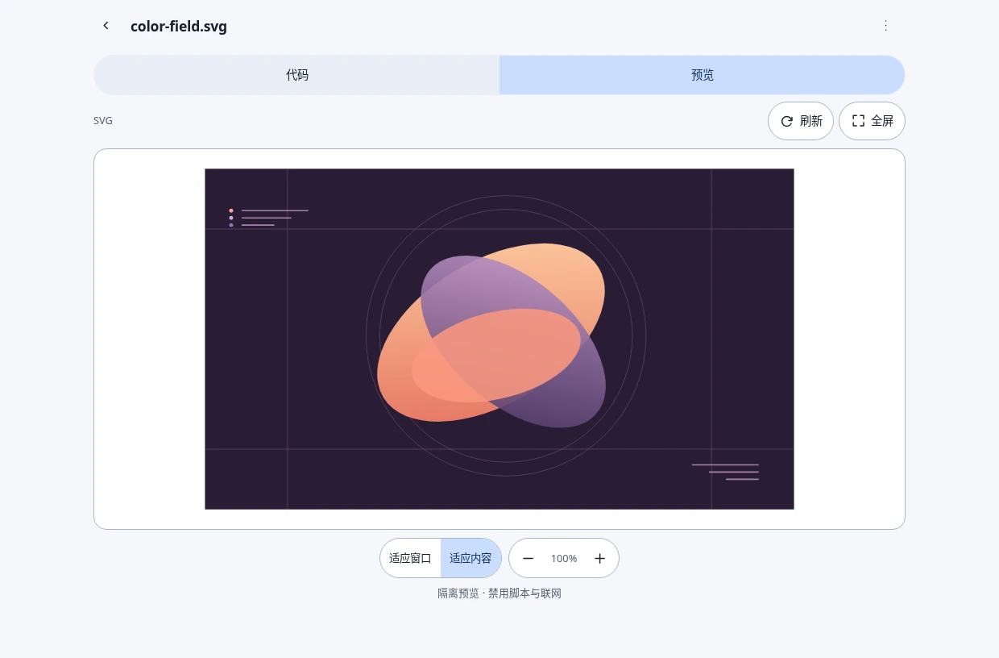
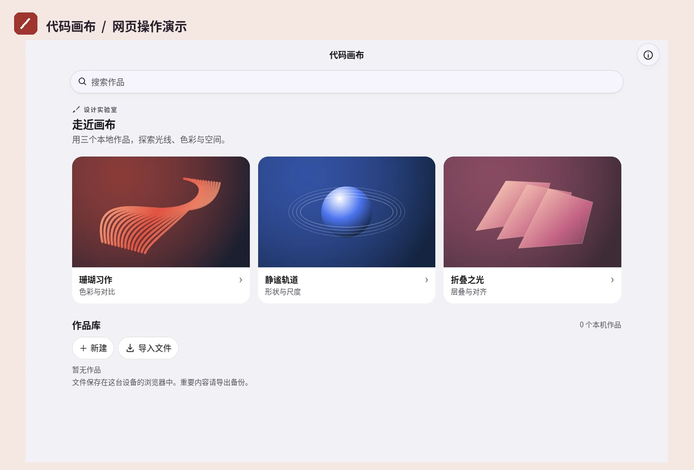

# 代码画布 · Code Canvas

[English](README.en.md) · [网页版](https://dsh.zhuquan.xyz/code-canvas/app/) · [安卓下载](https://github.com/zhuquan7237/code-canvas/releases/latest) · [中文实拍演示](https://dsh.zhuquan.xyz/code-canvas/#demo)

把 AI 聊天里的代码或手头的文件，变成**能预览、能修改、能导出的作品**。无需账号；源文件和草稿留在本机。

## 从哪一版开始？

| 你想做什么 | 推荐版本 |
| --- | --- |
| 在 Windows、Mac、iPhone、iPad 或 Android 上直接试用 | [打开网页版 PWA](https://dsh.zhuquan.xyz/code-canvas/app/)。支持 HTML / SVG 的隔离预览、文本编辑、本地草稿与文件导出。首次成功加载缓存后，在支持的浏览器中可离线打开。 |
| 在 Android 上打开更多格式、通过系统分享导入或导出 | [下载安卓 APK](https://github.com/zhuquan7237/code-canvas/releases/latest)，Android 8.0 及以上。支持 HTML、SVG、Markdown、Mermaid、JSON/JSONL、XML、YAML、CSV、常用文本代码、图片/动图、PDF，功能因格式而异。 |
| 查看原生 Apple UI 设计 | [SwiftUI 设计样机](https://github.com/zhuquan7237/code-canvas/releases/tag/v0.6.6)。是 Xcode 源码，不是可安装的 iOS 正式版。 |
| 使用已有 Windows 原生工具 | [Windows 原生版 v0.5.0](https://relay.zhuquan.xyz/dl/CodeCanvas-Setup-0.5.0.exe)。不是网页版；它的版本与功能范围独立。 |

## 30 秒上手

1. 打开网页版，先加载内置样例，或粘贴代码、导入本地文件。
2. 切换到**预览**看效果，切回**源码**编辑。网页版的 HTML／SVG 预览不执行脚本，也不加载联网资源；其他文本按源码查看。
3. **导出**留一份文件。网页版草稿只留在当前浏览器，不跨设备同步，清除站点数据前先导出。当前每个文件最多 512 KB，浏览器工作区最多保留 8 份草稿。

**安卓**：点「粘贴」，也可以从其他应用通过系统分享打开；作品库支持搜索、文件类型筛选、列表或网格。
**iPhone/iPad**：Safari 打开网页版 → 分享 → 添加到主屏幕；如果看到「作为网页 App 打开」，可开启。[Apple 操作说明](https://support.apple.com/guide/iphone/iphea86e5236/ios)

## 看实拍演示

[在线播放](https://dsh.zhuquan.xyz/code-canvas/#demo) · [英文配音版](https://dsh.zhuquan.xyz/code-canvas/en/#demo)

## 开发与边界

- 网页：[源码](web/app/)；本地运行 `python3 -m http.server 8000 -d web/app`，打开 `http://localhost:8000/`。直接双击 HTML 时，离线缓存功能不会工作。
- 安卓：[源码](app/)；安装 JDK 17 和 Android SDK 35，运行 `./gradlew testDebugUnitTest assembleDebug`。请勿用调试签名覆盖安装正式版。
- [安卓历史版本说明与旧资料](docs/ANDROID-HISTORY.md) · [预览与验证记录](docs/VERIFICATION.md) · [发布记录](https://github.com/zhuquan7237/code-canvas/releases) · [许可证](LICENSE)
